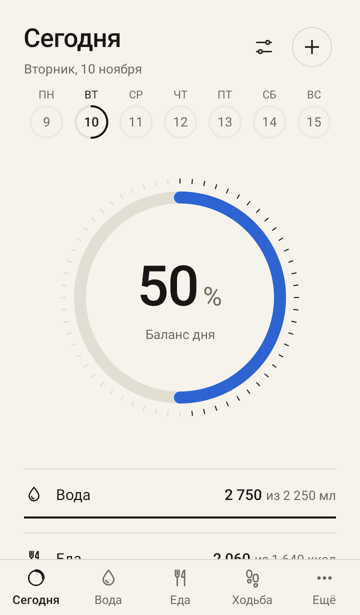
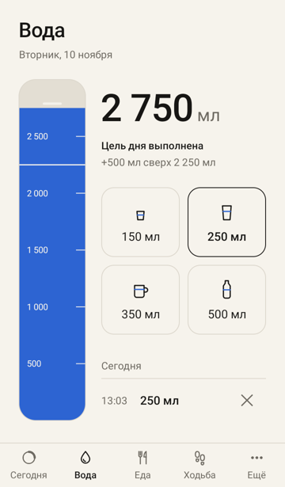
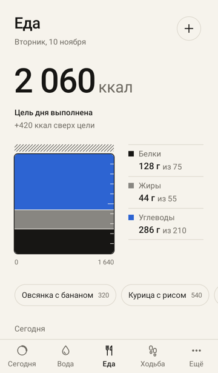
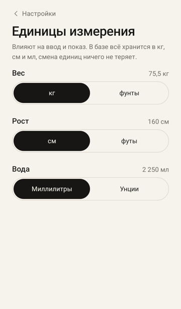
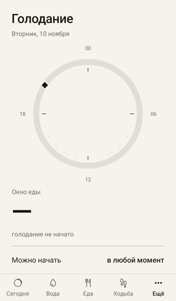
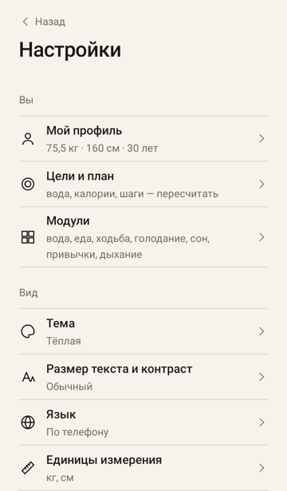

<div align="center">

# XO

**Вода, еда и шаги за день — одно кольцо «Баланс дня».**

Строгий минимализм, точные анимации, все данные только на телефоне.

[](https://github.com/skizewike/projectxo/releases/latest)


<br>

&nbsp;
&nbsp;


&nbsp;
&nbsp;


</div>

---

## Что умеет

| | |
|---|---|
| **Сегодня** | Одно большое кольцо «Баланс дня» по включённым модулям. Полоса недели и календарь с кольцами прошлых дней. |
| **Вода** | Сосуд со шкалой, порции в один тап, своя порция, мл или унции. Отмена записи. |
| **Еда** | Ручной ввод: калории, белки, жиры, углеводы. Быстрые шаблоны. Квадрат заполняется слоями БЖУ. |
| **Ходьба** | Шаги считаются сами: датчик шагов телефона, а без него — по движению телефона. Шаги по часам, расстояние по росту. |
| **Ещё** | Голодание и сон (таймеры от сохранённого начала), привычки с домашними тренировками, дыхание. |
| **План** | Первый запуск считает личную норму воды, калорий, БЖУ и шагов по полу, возрасту, росту, весу и цели. |
| **Профиль** | Графики веса, шагов, воды, калорий и самочувствия. Итог недели, выгрузка в CSV. |
| **Виджет** | Кольцо дня и кнопка «+250 мл» прямо на рабочем столе. Мягкие напоминания с тихими часами. |

## Для всех

- Светлая и тёмная тема по телефону, 4 темы на выбор.
- Крупный текст до 200 %, высокий контраст, режим «меньше анимаций», TalkBack.
- Русский и английский.
- Цели без давления: без стыдящих формулировок.

## Приватность

Нет аккаунтов, облака, рекламы и аналитики. Все записи хранятся в базе на телефоне. Подробно: [docs/PRIVACY.md](docs/PRIVACY.md).

## Установка

1. Скачайте `XO-*.apk` со страницы [Releases](https://github.com/skizewike/projectxo/releases/latest).
2. Откройте файл на телефоне и разрешите установку из этого источника.
3. После первого запуска разрешите «Физическую активность», чтобы шаги считались сами.

Нужен Android 8.0 или новее. Это тестовая сборка, не из Google Play.

## Сборка из исходников

```bash
cd app
./gradlew :app:testDebugUnitTest :app:assembleDebug
```

APK: `app/app/build/outputs/apk/debug/app-debug.apk`.

Релиз для Google Play подписывается ключом из `app/keystore.properties` (в репозиторий не попадает):

```
storeFile=../upload.jks
storePassword=…
keyAlias=upload
keyPassword=…
```

```bash
cd app
./gradlew :app:bundleRelease
```

## Как устроено

- Kotlin, Jetpack Compose, свои дизайн-токены поверх Material 3.
- Room для данных, WorkManager для напоминаний, служба переднего плана для шагов.
- UI и логика отделены от Android API: задел под Compose Multiplatform.
- `minSdk 26`, `targetSdk 36`.

## Документы

- [docs/PRODUCT.md](docs/PRODUCT.md) — что делаем.
- [docs/DESIGN.md](docs/DESIGN.md) — токены, шрифт, сетка, тайминги анимаций.
- [docs/DECISIONS.md](docs/DECISIONS.md) — журнал решений.
- [docs/PLAN-CALC.md](docs/PLAN-CALC.md) — формулы личного плана.
- [tests/TESTER-CHECKLIST.md](tests/TESTER-CHECKLIST.md) — ручная проверка.
